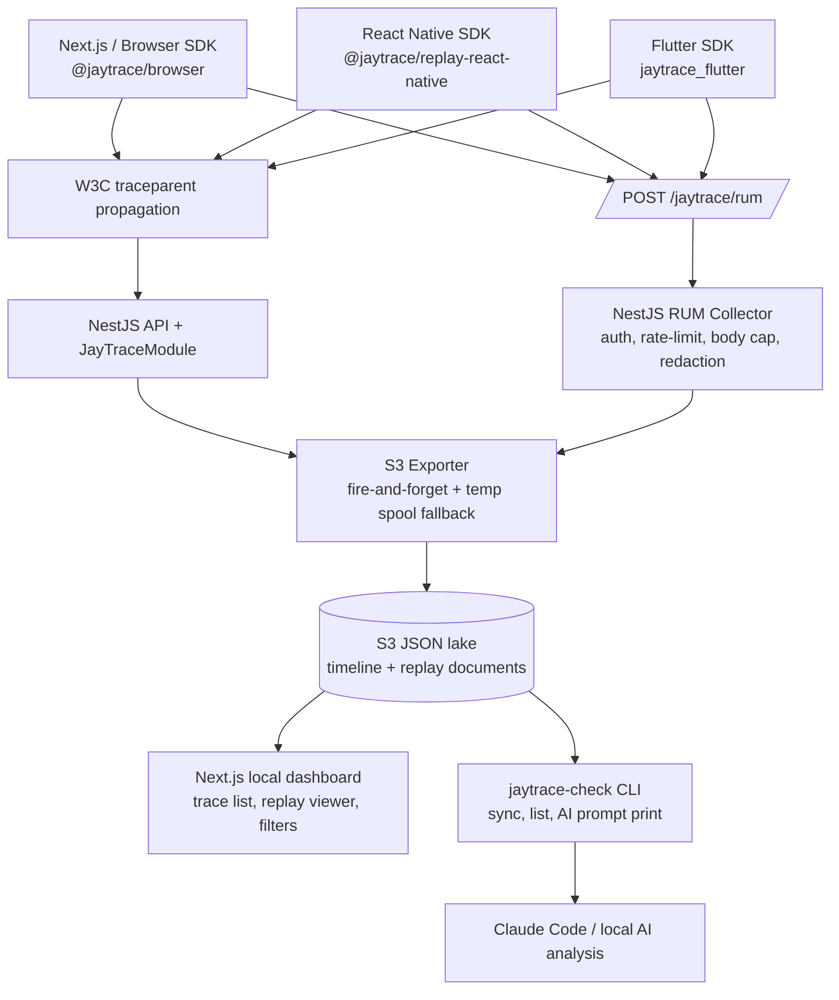

# JayTrace Final Architecture Spec

JayTrace is a hybrid RUM and replay system for Web, React Native, and Flutter. SDKs send redacted timeline/replay documents to the server collector; the collector writes S3-partitioned JSON; the local console and `jaytrace-check` CLI sync or read those files for AI-assisted debugging.

## System Architecture



## Implemented Packages

| Layer | Package | Responsibility |
| --- | --- | --- |
| Shared core | `@jaytrace/core` | W3C traceparent, timeline schema, redaction |
| Web SDK | `@jaytrace/browser` | browser/Next.js RUM, fetch/XHR capture, DOM replay, performance signals |
| Replay core | `@jaytrace/replay-core` | replay schema, ring buffer, document builder |
| React Native SDK | `@jaytrace/replay-react-native` | RN fetch tracing, ErrorUtils capture, navigation tracking, app-state flush, screenshot/view-tree replay hooks |
| Flutter SDK | `jaytrace_flutter` | Flutter replay, NavigatorObserver, framework/platform error guards, lifecycle flush |
| Backend collector | `@jaytrace/nestjs` | RUM ingest, request context, S3 export, spool fallback |
| Local AI CLI | `@jaytrace/cli` | S3 sync, trace listing, AI-ready prompt output |
| Dashboard | `apps/next-app` | local trace console and replay viewer |

## One-Line Integration Guides

### Web / Next.js

```ts
import { initJayTraceNext } from "@jaytrace/browser/next";

initJayTraceNext({
  service: "web",
  endpoint: "/jaytrace/rum",
  traceOrigins: ["https://api.example.com"],
  replay: { enabled: true, mode: "on-error", privacy: "mask-all" }
});
```

For App Router collector proxy:

```ts
import { createJayTraceRumProxy } from "@jaytrace/browser/next/rum-route";

export const runtime = "nodejs";
export const POST = createJayTraceRumProxy();
```

### React Native

```ts
import { AppState } from "react-native";
import { createReactNavigationReplayTracker, initJayTraceReactNative } from "@jaytrace/replay-react-native";

const jaytrace = initJayTraceReactNative({
  apiKey,
  endpoint: "https://api.example.com/jaytrace/rum",
  traceOrigins: ["https://api.example.com"],
  appState: AppState,
  release: appVersion,
  environment: "production",
  replay: { enabled: true, mode: "on-error", privacy: "mask-all" }
});

const tracker = createReactNavigationReplayTracker(jaytrace.replay, navigationRef);
```

Navigation binding:

```tsx
<NavigationContainer
  ref={navigationRef}
  onReady={tracker.onReady}
  onStateChange={tracker.onStateChange}
>
  {children}
</NavigationContainer>
```

### Flutter

```dart
import 'package:jaytrace_flutter/jaytrace_flutter.dart';
import 'package:jaytrace_flutter/jaytrace_flutter_widgets.dart';

final jaytrace = initJayTraceFlutterWidgets(
  apiKey: apiKey,
  endpoint: Uri.parse('https://api.example.com/jaytrace/rum'),
  traceOrigins: ['https://api.example.com'],
  release: appVersion,
  environment: 'production',
  replay: const JayTraceFlutterReplayOptions(enabled: true),
  sender: sendWithYourHttpClient,
);
```

App bootstrap:

```dart
await runJayTraceGuarded(jaytrace.replay, () async {
  runApp(MaterialApp(
    navigatorObservers: [JayTraceNavigatorObserver(jaytrace.replay)],
    home: App(replay: jaytrace.replay),
  ));
});
```

## S3 Partitioning

Timeline and replay files share the same trace folder:

```txt
s3://bucket/{env}/{yyyy}/{mm}/{dd}/{traceId}/{side}-{timestamp}.json
s3://bucket/{env}/{yyyy}/{mm}/{dd}/{traceId}/replay-web-{timestamp}.json
s3://bucket/{env}/{yyyy}/{mm}/{dd}/{traceId}/replay-react-native-{timestamp}.json
s3://bucket/{env}/{yyyy}/{mm}/{dd}/{traceId}/replay-flutter-{timestamp}.json
```

Document schemas:

| Document | Schema | Key fields |
| --- | --- | --- |
| Front timeline | `jaytrace.timeline.v1` | `service`, `side: front`, `traceId`, `traceparent`, `context`, `timeline` |
| Back timeline | `jaytrace.timeline.v1` | `service`, `side: back`, `traceId`, `context.route`, `error`, `timeline` |
| Replay | `jaytrace.replay.v1` | `platform`, `sessionId`, `mode`, `metadata`, `events`, `frames`, `mutations` |

Data rules:

- Browser SDKs never receive AWS credentials; they only send to `/jaytrace/rum`.
- Sensitive keys such as `password`, `token`, `authorization`, `cookie`, and `apiKey` are redacted inside exported documents.
- Web DOM snapshots are capped; RN/Flutter screenshot frames are capped at 320 KB by default.
- Mobile screenshots may contain visible PII. Skip or mask payment, identity, health, and auth screens before capture.

## Local AI and Operations Commands

```bash
# full project verification
pnpm check

# local console
pnpm dev:console

# local console reading S3
JAYTRACE_BUCKET=jaytrace-prod JAYTRACE_S3_PREFIX=production AWS_REGION=ap-northeast-2 pnpm dev:console

# sync S3 JSON locally for AI/debugging
jaytrace-check --sync-s3 s3://jaytrace-prod

# inspect traces
jaytrace-check --list
jaytrace-check --list --session-id session-rn
jaytrace-check --list --platform web

# print AI-ready trace context
jaytrace-check --ai print --trace-id 4bf92f3577b34da6a3ce929d0e0e4736
```

## Regression Dataset

Regression fixtures should be JSON files or JSONL records that match the exported S3 document shape. Keep one trace folder per scenario and include `expected` assertions beside the mock documents so CLI/dashboard tests can validate behavior without live devices.

### Scenario 1: Offline Buffer Then Reconnect

Purpose: prove SDK buffers are not dropped when network/S3 export fails, then are flushed once connectivity returns.

Mock dataset path:

```txt
regression/offline-reconnect/prod/2026/07/01/aaaaaaaaaaaaaaaaaaaaaaaaaaaaaaaa/
```

Mock records:

```json
{
  "scenario": "offline-reconnect",
  "input": [
    {
      "file": "replay-react-native-2026-07-01T12-00-00-000Z.json",
      "document": {
        "schema": "jaytrace.replay.v1",
        "platform": "react-native",
        "traceId": "aaaaaaaaaaaaaaaaaaaaaaaaaaaaaaaa",
        "sessionId": "session-offline-rn",
        "mode": "on-error",
        "startedAt": "2026-07-01T12:00:00.000Z",
        "endedAt": "2026-07-01T12:00:15.000Z",
        "metadata": { "view.name": "Checkout", "replay.screenshot": "missing" },
        "events": [
          "0.000s route screen Checkout",
          "2.100s gesture action RetryPayment",
          "5.000s network POST redacted error=Network request failed",
          "14.000s network POST redacted status=201 durationMs=90"
        ]
      }
    }
  ],
  "expected": {
    "lostEvents": 0,
    "containsFailureAndRecovery": true,
    "sameSessionId": "session-offline-rn",
    "dashboardBadges": ["network:error", "network:recovered"]
  }
}
```

### Scenario 2: Minified Stack Trace With Release Tag

Purpose: prove minified Web errors remain traceable by release/environment tags and still join backend failures by `traceId`.

Mock dataset path:

```txt
regression/minified-stack/prod/2026/07/01/bbbbbbbbbbbbbbbbbbbbbbbbbbbbbbbb/
```

Mock records:

```json
{
  "scenario": "minified-stack",
  "input": [
    {
      "file": "front-2026-07-01T12-10-00-000Z.json",
      "document": {
        "schema": "jaytrace.timeline.v1",
        "service": "web",
        "side": "front",
        "traceId": "bbbbbbbbbbbbbbbbbbbbbbbbbbbbbbbb",
        "traceparent": "00-bbbbbbbbbbbbbbbbbbbbbbbbbbbbbbbb-1111111111111111-01",
        "startedAt": "2026-07-01T12:10:00.000Z",
        "endedAt": "2026-07-01T12:10:03.000Z",
        "summary": "Minified checkout error before payment API call.",
        "context": { "url": "/checkout", "release": "web-2.4.1", "environment": "prod" },
        "error": {
          "name": "TypeError",
          "message": "Cannot read properties of undefined",
          "stack": "TypeError: Cannot read properties of undefined at t.pay (app-4f3a9c.js:1:42311)"
        },
        "timeline": [
          "0.000s navigation info page loaded /checkout",
          "2.900s error error TypeError Cannot read properties of undefined"
        ]
      }
    },
    {
      "file": "back-2026-07-01T12-10-03-050Z.json",
      "document": {
        "schema": "jaytrace.timeline.v1",
        "service": "api",
        "side": "back",
        "traceId": "bbbbbbbbbbbbbbbbbbbbbbbbbbbbbbbb",
        "traceparent": "00-bbbbbbbbbbbbbbbbbbbbbbbbbbbbbbbb-2222222222222222-01",
        "startedAt": "2026-07-01T12:10:03.000Z",
        "endedAt": "2026-07-01T12:10:03.050Z",
        "summary": "POST /api/pay returned 500.",
        "context": { "route": "/api/pay", "method": "POST", "statusCode": 500 },
        "timeline": ["0.000s request info request POST /api/pay", "0.050s error error PaymentGatewayError"]
      }
    }
  ],
  "expected": {
    "joinedByTraceId": true,
    "release": "web-2.4.1",
    "aiPromptContains": ["app-4f3a9c.js:1:42311", "POST /api/pay", "PaymentGatewayError"]
  }
}
```

### Scenario 3: Mobile Replay Without Screenshot Provider

Purpose: prove dashboard/CLI do not fail when mobile replay has event timelines but no image frames.

Mock dataset path:

```txt
regression/mobile-no-screenshot/prod/2026/07/01/cccccccccccccccccccccccccccccccc/
```

Mock records:

```json
{
  "scenario": "mobile-no-screenshot",
  "input": [
    {
      "file": "replay-flutter-2026-07-01T12-20-00-000Z.json",
      "document": {
        "schema": "jaytrace.replay.v1",
        "platform": "flutter",
        "traceId": "cccccccccccccccccccccccccccccccc",
        "sessionId": "session-flutter-no-shot",
        "mode": "on-error",
        "startedAt": "2026-07-01T12:20:00.000Z",
        "endedAt": "2026-07-01T12:20:06.000Z",
        "metadata": {
          "view.name": "Checkout",
          "replay.screenshot": "missing",
          "release": "flutter-1.9.0",
          "environment": "prod"
        },
        "events": [
          "0.000s route route Checkout",
          "1.200s gesture tap PayButton x=140 y=620",
          "3.000s network POST redacted status=503 durationMs=44",
          "3.100s error error StateError: payment failed"
        ]
      }
    }
  ],
  "expected": {
    "rendersWithoutFrames": true,
    "showsScreenshotsMissing": true,
    "containsTapCoordinates": true,
    "platformFilter": "flutter"
  }
}
```

## Final Release Checklist

- `pnpm check` passes before packaging.
- Collector `maxRumPayloadBytes` matches Web DOM replay and mobile screenshot limits.
- S3 lifecycle/CORS/IAM files under `infra/aws/` are applied per environment.
- Public SDK keys stay in clients; S3/AWS credentials stay only on collector/console hosts.
- Regression fixtures above ship as `regression/scenarios/*.json` with a runner (`regression/run-regression.mjs`, `pnpm test:regression`) that loads them, exercises the real CLI join/prompt/list logic, and asserts every `expected` field with no live devices. It is wired into `pnpm check` (runs after `pnpm build`).
